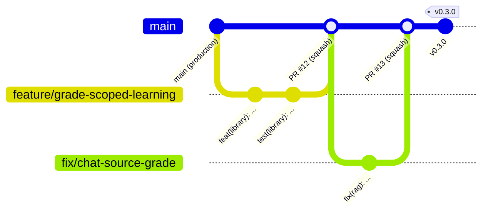

# Quy trình Git và quy ước commit

Tài liệu này là quy định chung của nhóm khi làm việc với repo Xuyên Sử Ký. Mục tiêu: nhìn lịch sử Git là biết ngay mỗi thay đổi **làm gì, ở đâu, vì sao**, và `main` lúc nào cũng deploy được.

## 1. Mô hình nhánh



| Nhánh | Dùng cho | Tạo từ | Gộp vào |
|---|---|---|---|
| `main` | Bản production. Mỗi lần push, CI chạy test rồi deploy lên Vercel | — | — |
| `feature/<tên>` | Tính năng mới | `main` | `main` qua PR |
| `fix/<tên>` | Sửa lỗi | `main` | `main` qua PR |
| `hotfix/<tên>` | Sửa lỗi khẩn trên production | `main` | `main` qua PR, ưu tiên review |
| `docs/<tên>` | Chỉ tài liệu | `main` | `main` qua PR |
| `refactor/<tên>`, `test/<tên>`, `chore/<tên>`, `ci/<tên>` | Tái cấu trúc, test, việc lặt vặt, CI | `main` | `main` qua PR |

Quy tắc:

- **Không commit thẳng lên `main`**. Mọi thay đổi đi qua pull request.
- Tên nhánh viết thường, nối bằng gạch ngang, đúng một việc: `feature/teacher-assignments`, `fix/journey-empty-grade`.
- Nhánh sống ngắn (vài ngày). Trước khi mở PR, cập nhật theo `main` bằng `git rebase origin/main` trên nhánh của mình. Chỉ rebase nhánh chưa ai khác dùng chung.
- **Không force-push lên `main`** và không viết lại lịch sử đã có trên `main`.
- Nhóm dùng mô hình rút gọn (GitHub Flow), không có nhánh `develop`, vì `main` đã được CI bảo vệ: test, build và deploy chỉ chạy khi mọi kiểm tra xanh. Khi cần chốt một bản để nộp hoặc demo, gắn tag theo mục 5.

## 2. Định dạng commit (Conventional Commits)

```text
<type>(<scope>): <mô tả ngắn>

<thân: vì sao thay đổi, thay đổi gì, ảnh hưởng gì>

<chân: BREAKING CHANGE: ..., Refs #12, Closes #12>
```

Ví dụ:

```text
feat(library): show only lessons of the student's grade

Signed-in students keep the grade chosen at registration. The library,
search, journeys and characters stay in that grade; grade choices only
appear on the landing page and in guest mode.

Closes #12
```

```text
fix(rag): answer date questions from another grade when the own grade has no year
```

### Type

| Type | Khi nào dùng | Ví dụ |
|---|---|---|
| `feat` | Tính năng mới cho người dùng | `feat(teacher): export class progress as CSV` |
| `fix` | Sửa lỗi | `fix(auth): keep the registration grade after guest mode` |
| `docs` | Chỉ tài liệu (README, docs/, comment hướng dẫn) | `docs: describe the git workflow` |
| `style` | Định dạng code, không đổi hành vi (khoảng trắng, dấu chấm phẩy) | `style(dashboard): format lesson grid markup` |
| `refactor` | Đổi cấu trúc code, không thêm tính năng, không sửa lỗi | `refactor(rag): split retrieval by grade` |
| `perf` | Tăng hiệu năng | `perf(search): cache normalized chunk text` |
| `test` | Thêm hoặc sửa test | `test(roles): cover wrong-role sign-in` |
| `build` | Build, dependency, cấu hình bundler | `build(deps): bump vite to 5.4.12` |
| `ci` | GitHub Actions, deploy | `ci: lint pull request titles` |
| `chore` | Việc lặt vặt không thuộc các loại trên | `chore: rename sample accounts` |
| `revert` | Hoàn tác commit trước | `revert: feat(library): show only lessons of the student's grade` |

Thay đổi giao diện người dùng thấy được là `feat` hoặc `fix`, không phải `style`.

### Scope

Phần trong ngoặc cho biết khu vực bị ảnh hưởng. Có thể bỏ khi thay đổi đi khắp nơi.

| Scope | Khu vực |
|---|---|
| `auth` | Đăng nhập, đăng ký, phiên, chọn vai trò |
| `roles`, `teacher`, `admin` | Phân quyền, khu giáo viên, khu quản trị |
| `dashboard` | Trang chủ học sinh `/home` |
| `library` | Thư viện SGK, màn đọc, sổ tay |
| `journey` | Hành trình game hoá, video nhiệm vụ |
| `characters`, `rag`, `speech` | Nhân vật AI, pipeline trả lời, giọng nói |
| `games` | Minigame |
| `landing` | Trang giới thiệu `/` |
| `api` | `server/handler.mjs` và các endpoint |
| `data`, `dataset` | `data/enrichment`, snapshot SGK, embeddings |
| `ui` | Thành phần giao diện dùng chung, CSS |
| `deps` | Dependency |

### Quy tắc viết

1. **Dòng đầu tối đa 72 ký tự**, không chấm cuối câu.
2. Mô tả ở **thể mệnh lệnh, hiện tại**: `add`, `fix`, `show`, không viết `added`, `fixes`. Bắt đầu bằng chữ thường.
3. Viết tiếng Anh cho thống nhất với lịch sử hiện có. Tên riêng tiếng Việt giữ nguyên dấu (`Dũng`, `Bạch Đằng`).
4. **Một commit, một ý.** Sửa lỗi và thêm tính năng tách thành hai commit. Test đi cùng commit của code nó kiểm tra, hoặc thành commit `test(...)` riêng ngay sau.
5. Thân commit trả lời *vì sao*. Diff đã cho thấy *cái gì*.
6. Thay đổi phá vỡ tương thích (đổi API, đổi khoá lưu trữ khiến dữ liệu cũ mất) ghi `!` sau type/scope **và** một dòng `BREAKING CHANGE:` ở chân:

   ```text
   feat(api)!: require grade for character chat

   BREAKING CHANGE: POST /api/characters/:id/chat returns 400 without grade.
   ```

7. Liên kết issue ở chân: `Refs #12` (liên quan) hoặc `Closes #12` (đóng issue khi gộp).
8. Không ghi tên công cụ AI, dòng `Co-Authored-By` của trợ lý AI hay link phiên làm việc. Hook tự xoá các dòng này.

Commit tạm trong lúc làm có thể ghi `fixup! <commit gốc>` hoặc `squash! ...`, rồi dọn bằng `git rebase -i --autosquash origin/main` trước khi mở PR.

## 3. Pull request

1. Mở PR từ nhánh của mình vào `main`. **Tiêu đề PR theo đúng định dạng commit**, vì PR được gộp kiểu *Squash and merge* và tiêu đề thành commit trên `main`.
2. Điền mẫu PR (tự hiện khi mở): thay đổi gì, vì sao, kiểm thử thế nào, ảnh chụp nếu đổi giao diện.
3. CI phải xanh: kiểm tra định dạng tiêu đề và commit, dataset, test backend, test trình duyệt, build.
4. Ít nhất một thành viên khác review, trừ hotfix khẩn.
5. Gộp bằng **Squash and merge**, xoá nhánh sau khi gộp. Push lên `main` sẽ tự deploy production; kiểm tra lại bản deploy sau khi gộp.

Chạy trước khi mở PR:

```bash
npm run check:dataset
npm run test:backend
npm run test:games
npm run build
```

## 4. Kiểm tra tự động

| Ở đâu | Kiểm tra gì |
|---|---|
| Máy cá nhân, hook `.githooks/commit-msg` | Xoá dòng ghi tên AI; từ chối commit sai định dạng hoặc dòng đầu dài quá 72 ký tự |
| GitHub Actions `Commit messages` (mỗi PR) | Tiêu đề PR và mọi commit trong PR đúng định dạng |
| GitHub Actions `CI/CD to Vercel` | Dataset, test backend, Playwright, build; deploy khi gộp vào `main` |

Hook được bật tự động khi chạy `npm ci` hoặc `npm install` (script `prepare`). Bật tay nếu cần:

```bash
git config core.hooksPath .githooks
```

Không bỏ qua hook bằng `--no-verify`. Commit gộp (`Merge ...`), `Revert "..."`, `fixup!` và `squash!` được hook chấp nhận.

## 5. Phiên bản và tag

Gắn tag theo [Semantic Versioning](https://semver.org/lang/vi/) trên `main` khi chốt một mốc (nộp checkpoint, demo):

- `MAJOR` khi có `BREAKING CHANGE`, `MINOR` khi có `feat`, `PATCH` khi chỉ có `fix`.
- Dự án đang ở `0.x`.

```bash
git checkout main && git pull
git tag -a v0.3.0 -m "v0.3.0: teacher and admin roles, grade-scoped learning"
git push origin v0.3.0
```

Nhờ định dạng commit thống nhất, danh sách thay đổi giữa hai mốc lấy được ngay:

```bash
git log v0.2.0..v0.3.0 --format='- %s' --no-merges
```

## 6. Lệnh thường dùng

```bash
# Bắt đầu việc mới
git checkout main && git pull
git checkout -b feature/teacher-assignments

# Commit theo quy ước
git add -p
git commit -m "feat(teacher): assign textbook lessons with a due date"

# Cập nhật theo main trước khi mở PR
git fetch origin
git rebase origin/main
git push -u origin feature/teacher-assignments

# Sửa commit cuối khi chưa push
git commit --amend
```
