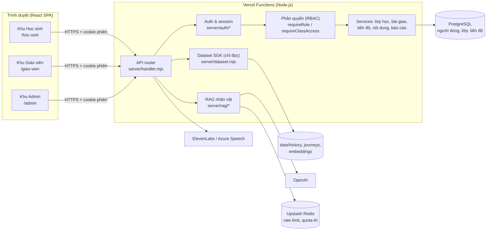
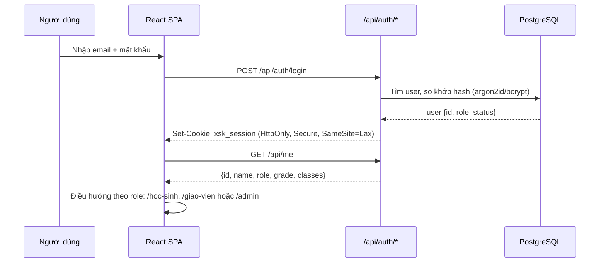
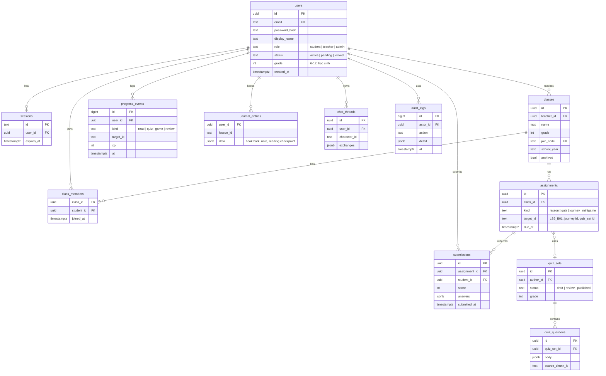

# Kiến trúc Xuyên Sử Ký: 3 vai trò Học sinh, Giáo viên, Admin

Tài liệu này mô tả kiến trúc mục tiêu khi Xuyên Sử Ký có tài khoản thật với ba vai trò: **Học sinh**, **Giáo viên** và **Admin**. Phần 1 tóm tắt hiện trạng, các phần sau là thiết kế đề xuất và lộ trình chuyển đổi.

## 1. Hiện trạng (nhánh `main`)

| Thành phần | Hiện tại |
|---|---|
| Frontend | React 18 + TypeScript + Vite + Tailwind; React Router với `/`, `/dang-nhap`, `/home` |
| Backend | Một handler Node.js (`server/handler.mjs`), chạy local qua `server/index.mjs` và trên Vercel qua `api/dataset.js` |
| Dữ liệu SGK | Snapshot chỉ đọc trong `data/history` (manifest, lessons, chunks, schema, checksum), `data/journeys`, `data/embeddings` |
| AI | RAG nhân vật lịch sử (OpenAI) có guardrails và giới hạn lượt; giọng nói qua ElevenLabs/Azure |
| Tài khoản | **Demo trên trình duyệt**: `localAccount.ts` lưu email + hash trong `localStorage`; phiên trong `sessionStorage` |
| Tiến độ học | `localStorage`: XP, minigame, sổ tay (`useLearningJournal`), lịch sử chat (`chatHistory.ts`) |
| Giới hạn | Rate limit theo IP, bộ đếm in-memory hoặc Upstash Redis |

Hệ quả: không có khái niệm vai trò, giáo viên không xem được tiến độ học sinh, dữ liệu không đồng bộ giữa thiết bị, và mọi kiểm tra quyền hiện chỉ nằm ở phía client.

## 2. Tổng quan kiến trúc mục tiêu



Nguyên tắc chính:

1. **Một SPA, ba khu giao diện.** Code chung (thư viện SGK, lesson reader, nhân vật) dùng lại; mỗi vai trò có layout và route riêng.
2. **Phân quyền ở server.** Client chỉ ẩn/hiện giao diện; mọi API kiểm tra vai trò và quyền sở hữu dữ liệu.
3. **Dataset SGK vẫn chỉ đọc và đóng gói theo bản build.** Dữ liệu động (người dùng, lớp, tiến độ, bài giao) chuyển sang PostgreSQL.
4. **Giữ API hiện có.** `/api/lessons`, `/api/search`, `/api/characters/...` không đổi hợp đồng; chỉ thêm nhóm route mới.

## 3. Vai trò và quyền

### 3.1 Mô tả vai trò

| Vai trò | Ai | Mục tiêu chính |
|---|---|---|
| **Học sinh** (`student`) | Học sinh lớp 6–12 | Đọc bài SGK, hành trình, minigame, quiz, trò chuyện với nhân vật, làm bài được giao, xem tiến độ của mình |
| **Giáo viên** (`teacher`) | Giáo viên Lịch sử | Tạo lớp, mời học sinh bằng mã lớp, giao bài/quiz/hành trình, theo dõi tiến độ và kết quả của lớp mình |
| **Admin** (`admin`) | Nhóm vận hành | Quản lý tài khoản và vai trò, duyệt giáo viên, quản lý nội dung và phiên bản dataset, cấu hình AI/quota, xem báo cáo hệ thống và nhật ký kiểm toán |

Khách (`guest`) vẫn được học thử như hiện nay nhưng không lưu tiến độ lên server và không vào khu Giáo viên/Admin.

### 3.2 Ma trận quyền

| Chức năng | Khách | Học sinh | Giáo viên | Admin |
|---|:-:|:-:|:-:|:-:|
| Đọc thư viện SGK, tìm kiếm, hành trình | ✅ | ✅ | ✅ | ✅ |
| Chat/voice với nhân vật (theo quota) | Giới hạn | ✅ | ✅ | ✅ |
| Lưu tiến độ, XP, sổ tay lên server | ❌ | ✅ (của mình) | ✅ (của mình) | ✅ |
| Tham gia lớp bằng mã | ❌ | ✅ | ❌ | ❌ |
| Làm và nộp bài được giao | ❌ | ✅ | ❌ | ❌ |
| Tạo/sửa/lưu trữ lớp học | ❌ | ❌ | ✅ (lớp mình) | ✅ (mọi lớp) |
| Giao bài, quiz, hành trình | ❌ | ❌ | ✅ (lớp mình) | ✅ |
| Xem tiến độ/kết quả học sinh | ❌ | Chỉ của mình | Chỉ học sinh trong lớp mình | ✅ |
| Xuất báo cáo lớp (CSV) | ❌ | ❌ | ✅ | ✅ |
| Quản lý tài khoản, đổi vai trò, khóa tài khoản | ❌ | ❌ | ❌ | ✅ |
| Duyệt đăng ký giáo viên | ❌ | ❌ | ❌ | ✅ |
| Quản lý ngân hàng câu hỏi, nội dung minigame | ❌ | ❌ | Đề xuất | ✅ (duyệt, xuất bản) |
| Cấu hình AI (bật/tắt, quota, model) | ❌ | ❌ | ❌ | ✅ |
| Xem nhật ký kiểm toán, thống kê hệ thống | ❌ | ❌ | ❌ | ✅ |

Quy tắc mặc định: **từ chối nếu không có quyền rõ ràng**. Giáo viên chỉ truy cập học sinh qua quan hệ `class_members` của lớp mình sở hữu, không qua ID người dùng tùy ý.

## 4. Xác thực và phiên



- **Đăng ký:** học sinh tự đăng ký (chọn khối như `GradeOnboarding` hiện tại) hoặc giáo viên tạo hàng loạt; giáo viên đăng ký ở trạng thái `pending` và chỉ dùng được sau khi admin duyệt; admin chỉ được tạo bằng script seed hoặc bởi admin khác.
- **Phiên:** cookie HttpOnly chứa ID phiên ngẫu nhiên, phiên lưu trong bảng `sessions` (thu hồi được). Không lưu token trong `localStorage`.
- **Mật khẩu:** băm ở server bằng argon2id hoặc bcrypt. Bỏ băm SHA-256 phía client trong `localAccount.ts` khi chuyển sang tài khoản thật.
- **Lựa chọn thay thế:** nếu muốn rút ngắn thời gian, dùng dịch vụ auth có sẵn (Supabase Auth, Clerk, Auth.js). Vai trò vẫn lưu trong bảng `users.role` của mình để RBAC không phụ thuộc nhà cung cấp.
- **CSRF:** các route thay đổi dữ liệu chỉ nhận `application/json` (handler đã bắt buộc) và kiểm tra header `Origin`.

## 5. Mô hình dữ liệu



Ghi chú:

- `target_id` tham chiếu ID trong dataset SGK (ví dụ `LS6_B01`) và được kiểm tra với dataset đã nạp, không tạo khóa ngoại tới file.
- `progress_events`, `journal_entries` và `chat_threads` thay thế các khóa `localStorage` hiện tại (`xuyen-su-ky-demo-v1`, `xuyen-su-ky-journal-v1`, `xuyen-su-ky-chat-v1`).
- Câu hỏi quiz nên gắn `source_chunk_id` để giữ nguyên tắc "có nguồn SGK" của dự án.

## 6. API

Các route hiện có giữ nguyên. Route mới đi qua cùng router và lớp phân quyền:

| Nhóm | Route | Vai trò |
|---|---|---|
| Auth | `POST /api/auth/register`, `POST /api/auth/login`, `POST /api/auth/logout`, `GET /api/me` | Công khai / đã đăng nhập |
| Học sinh | `GET/POST /api/me/progress`, `GET/PUT /api/me/journal`, `GET/PUT /api/me/chats/:characterId` | `student` (và mọi user cho dữ liệu của chính mình) |
| | `POST /api/classes/join` `{ code }` | `student` |
| | `GET /api/me/assignments`, `POST /api/assignments/:id/submit` | `student`, phải là thành viên lớp |
| Giáo viên | `GET/POST /api/teacher/classes`, `PATCH /api/teacher/classes/:id` | `teacher`, sở hữu lớp |
| | `GET /api/teacher/classes/:id/students`, `DELETE .../students/:studentId` | `teacher`, sở hữu lớp |
| | `POST /api/teacher/classes/:id/assignments`, `GET .../assignments/:aid/submissions` | `teacher`, sở hữu lớp |
| | `GET /api/teacher/classes/:id/report?format=csv` | `teacher`, sở hữu lớp |
| | `POST /api/teacher/quiz-sets` (bản nháp, gửi duyệt) | `teacher` |
| Admin | `GET /api/admin/users`, `PATCH /api/admin/users/:id` (role, status) | `admin` |
| | `GET /api/admin/teacher-requests`, `POST .../:id/approve` | `admin` |
| | `PATCH /api/admin/quiz-sets/:id` (duyệt, xuất bản) | `admin` |
| | `GET/PUT /api/admin/settings/ai` (AI_DISABLED, quota, model) | `admin` |
| | `GET /api/admin/stats`, `GET /api/admin/audit-logs` | `admin` |

Mẫu kiểm tra quyền trong handler:

```js
// server/auth/guards.mjs
export function requireRole(user, ...roles) {
  if (!user) throw new HttpError(401, 'UNAUTHENTICATED', 'Bạn cần đăng nhập.')
  if (user.status !== 'active') throw new HttpError(403, 'ACCOUNT_INACTIVE', 'Tài khoản chưa được kích hoạt.')
  if (!roles.includes(user.role)) throw new HttpError(403, 'FORBIDDEN', 'Bạn không có quyền truy cập.')
}

export async function requireClassOwner(db, user, classId) {
  requireRole(user, 'teacher', 'admin')
  if (user.role === 'admin') return
  const owns = await db.classes.exists({ id: classId, teacher_id: user.id })
  if (!owns) throw new HttpError(404, 'CLASS_NOT_FOUND', 'Không tìm thấy lớp.') // 404 để không lộ lớp của người khác
}
```

Để `server/handler.mjs` không phình to, tách thành các module route: `server/routes/{dataset,characters,auth,student,teacher,admin}.mjs`, handler chỉ làm việc phân luồng, đọc phiên và xử lý lỗi chung.

## 7. Frontend

```
src/
  app/
    AppRouter.tsx          # route theo vai trò
    RequireRole.tsx        # guard giao diện (server vẫn kiểm tra lại)
    AuthProvider.tsx       # gọi /api/me, cung cấp user + role
  features/
    student/               # dashboard hiện tại, bài được giao, tiến độ
    teacher/               # lớp học, giao bài, báo cáo
    admin/                 # người dùng, duyệt giáo viên, nội dung, cấu hình AI
  shared/                  # LessonReader, CharacterChatModal, DatasetLibrary... dùng chung
```

| Route | Vai trò | Màn hình chính |
|---|---|---|
| `/`, `/dang-nhap`, `/dang-ky` | Công khai | Landing, đăng nhập, đăng ký (chọn "Học sinh" hoặc "Giáo viên") |
| `/hoc-sinh` | `student` | Dashboard hiện tại (`/home`), thêm "Bài được giao" và "Lớp của em" |
| `/hoc-sinh/bai/:lessonId`, `/hoc-sinh/nhiem-vu/:id` | `student` | Đọc bài, làm bài giao |
| `/giao-vien` | `teacher` | Danh sách lớp, hoạt động gần đây |
| `/giao-vien/lop/:id` | `teacher` | Học sinh, bài giao, bảng tiến độ, xuất CSV |
| `/giao-vien/ngan-hang-cau-hoi` | `teacher` | Soạn quiz từ đoạn SGK, gửi duyệt |
| `/admin` | `admin` | Thống kê, tài khoản, duyệt giáo viên, nội dung, cấu hình AI, nhật ký |

`/home` chuyển hướng tới khu tương ứng với vai trò để giữ các liên kết cũ. `RequireSession` trong `App.tsx` mở rộng thành `RequireRole roles={[...]}`.

## 8. Bảo mật và quyền riêng tư

- Học sinh phần lớn là người chưa thành niên: thu thập tối thiểu (tên hiển thị, email hoặc tài khoản do trường cấp, khối), không công khai email trên bảng xếp hạng, cho phép xóa tài khoản và dữ liệu.
- Lịch sử chat với nhân vật là riêng tư của học sinh; giáo viên chỉ xem thống kê tổng hợp (số câu hỏi, bài liên quan), không xem nội dung, trừ khi chính sách trường yêu cầu và có thông báo rõ.
- Ghi `audit_logs` cho mọi thao tác của admin và thao tác nhạy cảm của giáo viên (xóa học sinh khỏi lớp, xuất báo cáo).
- Quota AI tính theo `user_id` khi đã đăng nhập (thay vì chỉ theo IP như `clientKey`), giữ giới hạn theo IP cho khách.
- Secrets (`OPENAI_API_KEY`, `DATABASE_URL`, khóa ElevenLabs) chỉ ở biến môi trường server, không dùng tiền tố `VITE_`.

## 9. Hạ tầng và triển khai

| Thành phần | Đề xuất |
|---|---|
| Hosting | Giữ Vercel (SPA + Functions), CI hiện tại trong `.github/workflows/deploy-vercel.yml` |
| Database | PostgreSQL serverless (Neon hoặc Supabase qua Vercel Marketplace), biến `DATABASE_URL` |
| Migration | Thư mục `server/db/migrations/*.sql`, chạy bằng script `npm run db:migrate` trong CI trước khi deploy |
| Cache / quota | Upstash Redis như hiện tại |
| Kiểm thử | Thêm test API phân quyền (`tests/rbac.test.mjs`: mỗi route × mỗi vai trò) và Playwright cho 3 luồng đăng nhập |

## 10. Lộ trình chuyển đổi

| Giai đoạn | Nội dung | Kết quả |
|---|---|---|
| **1. Nền tảng tài khoản** | Thêm PostgreSQL, bảng `users`/`sessions`, `/api/auth/*`, `/api/me`, guard `requireRole`; seed 1 admin | Đăng nhập thật, có vai trò |
| **2. Học sinh** | Chuyển tiến độ, sổ tay, chat từ `localStorage` lên server; khi đăng nhập lần đầu đề nghị nhập dữ liệu local hiện có | Đồng bộ giữa thiết bị |
| **3. Giáo viên** | Lớp học, mã tham gia, bài giao, bảng tiến độ, xuất CSV | Giáo viên theo dõi được lớp |
| **4. Admin** | Quản lý người dùng, duyệt giáo viên, cấu hình AI, nhật ký kiểm toán, duyệt ngân hàng câu hỏi | Vận hành không cần sửa code |
| **5. Hoàn thiện** | Bảng xếp hạng theo lớp thật (thay `leaderboard.ts` demo), thông báo bài giao, test RBAC đầy đủ | Bỏ hết dữ liệu demo |

Mỗi giai đoạn giữ chế độ **Khách** và **Bài học thử** hoạt động như hiện nay để bản demo không bị gián đoạn.
