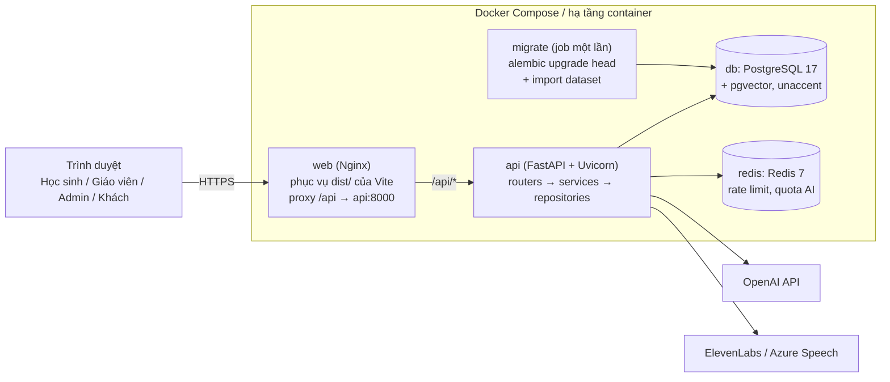
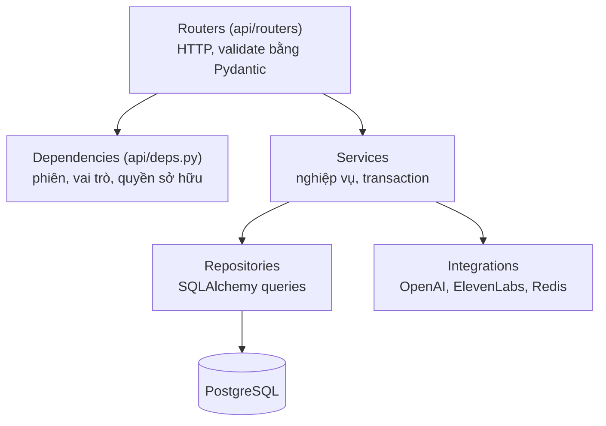
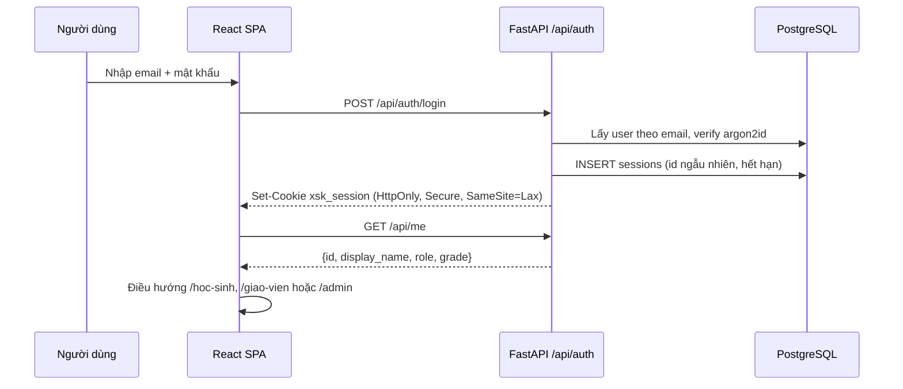
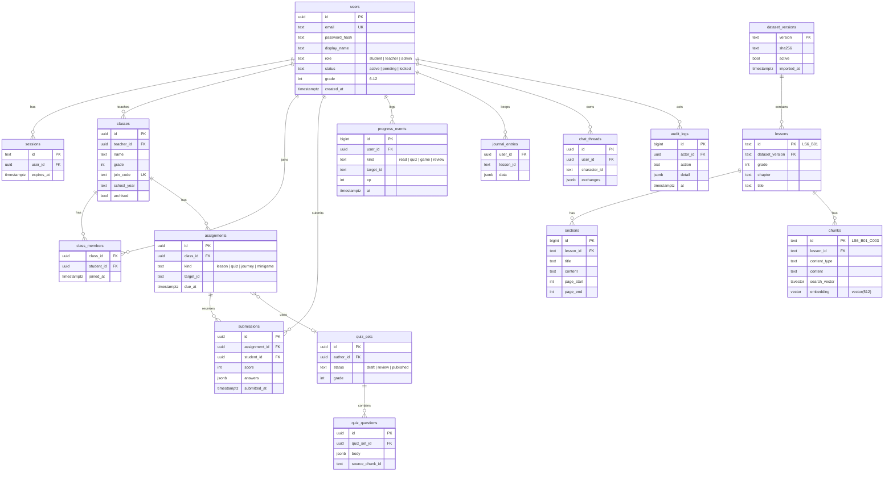
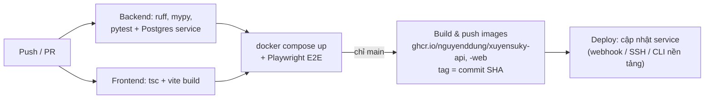

# Kiến trúc Xuyên Sử Ký: FastAPI, PostgreSQL, Docker và 3 vai trò

Tài liệu mô tả kiến trúc mục tiêu của Xuyên Sử Ký:

- **Backend Python FastAPI** thay cho backend Node.js hiện tại (`server/*.mjs`).
- **PostgreSQL** (kèm `pgvector`) lưu người dùng, lớp học, tiến độ, dataset SGK và vector RAG; **Redis** cho rate limit và quota AI.
- **Docker / Docker Compose** đóng gói toàn bộ hệ thống để chạy giống nhau ở máy dev, VPS hay bất kỳ nền tảng container nào.
- **Ba vai trò:** Học sinh, Giáo viên, Admin (và chế độ Khách như hiện nay).

Frontend React + Vite giữ nguyên, chỉ đổi nơi gọi API và thêm các khu giao diện theo vai trò.

## 1. Hiện trạng (nhánh `main`)

| Thành phần | Hiện tại | Hướng đi |
|---|---|---|
| Frontend | React 18 + TypeScript + Vite + Tailwind, route `/`, `/dang-nhap`, `/home` | Giữ, thêm `/hoc-sinh`, `/giao-vien`, `/admin` |
| Backend | Node.js: `server/handler.mjs`, chạy trên Vercel qua `api/dataset.js` | Viết lại bằng FastAPI, **giữ nguyên hợp đồng `/api/*`** |
| Dataset SGK | File JSON/JSONL trong `data/history`, nạp vào RAM mỗi tiến trình | Import vào PostgreSQL bằng script có kiểm tra checksum + schema |
| Vector RAG | `data/embeddings/vectors.bin` (text-embedding-3-small, 512 chiều, int8) | Cột `vector(512)` trong PostgreSQL (`pgvector`) |
| AI / giọng nói | OpenAI (RAG nhân vật), ElevenLabs/Azure Speech | Giữ nhà cung cấp, chuyển sang SDK Python |
| Tài khoản | Demo trên trình duyệt (`localStorage`), không có vai trò | Tài khoản thật, phiên cookie HttpOnly, RBAC ở server |
| Tiến độ, sổ tay, chat | `localStorage` | Bảng PostgreSQL theo `user_id` |
| Rate limit | In-memory hoặc Upstash Redis | Redis (container hoặc dịch vụ quản lý) |
| Triển khai | Vercel (SPA + Functions) qua GitHub Actions | Docker images trên GHCR, chạy ở bất kỳ hạ tầng nào |

## 2. Lựa chọn công nghệ

| Lớp | Công nghệ | Lý do |
|---|---|---|
| Ngôn ngữ backend | Python 3.12 | Hệ sinh thái AI/RAG tốt, nhóm quen Python |
| Web framework | FastAPI + Uvicorn | Async, tự sinh OpenAPI/Swagger, dependency injection gọn cho phân quyền |
| Validation | Pydantic v2 + pydantic-settings | Schema request/response và cấu hình qua biến môi trường |
| ORM / truy vấn | SQLAlchemy 2.0 (async) + asyncpg | Chuẩn, hỗ trợ tốt PostgreSQL và pgvector |
| Migration | Alembic | Quản lý thay đổi schema có phiên bản |
| Database | PostgreSQL 17 + extension `pgvector`, `unaccent` | Dữ liệu quan hệ + tìm kiếm vector + full-text tiếng Việt trong một chỗ |
| Cache / quota | Redis 7 | Rate limit, quota AI theo ngày, cache kết quả tìm kiếm |
| Băm mật khẩu | argon2id (`argon2-cffi` hoặc `pwdlib`) | Chuẩn hiện đại cho mật khẩu |
| AI | `openai` Python SDK, `elevenlabs` Python SDK | Tương đương SDK Node đang dùng |
| Quản lý gói | `uv` + `pyproject.toml` + `uv.lock` | Cài nhanh, lockfile tái lập được trong Docker |
| Kiểm thử | pytest + httpx (`AsyncClient`) + testcontainers/Postgres service; Playwright cho E2E | Test API thật với database thật |
| Chất lượng code | ruff (lint + format), mypy | Bắt lỗi sớm trong CI |
| Đóng gói | Docker multi-stage, Docker Compose | Một lệnh chạy cả hệ thống; image dùng lại ở mọi hạ tầng |
| Reverse proxy | Nginx (phục vụ build Vite + proxy `/api`) | Một origin cho frontend và API, không cần CORS |

## 3. Tổng quan hệ thống (container)



Luồng một request: trình duyệt → Nginx → FastAPI → dependency đọc phiên và kiểm tra vai trò → service → repository (SQLAlchemy) → PostgreSQL. Gọi OpenAI/ElevenLabs chỉ xảy ra ở backend; khóa API không bao giờ xuống client.

## 4. Vai trò và quyền

### 4.1 Vai trò

| Vai trò | Ai | Mục tiêu chính |
|---|---|---|
| **Học sinh** (`student`) | Học sinh lớp 6–12 | Đọc bài SGK, hành trình, minigame, quiz, trò chuyện với nhân vật, làm bài được giao, xem tiến độ của mình |
| **Giáo viên** (`teacher`) | Giáo viên Lịch sử | Tạo lớp, mời học sinh bằng mã lớp, giao bài/quiz/hành trình, theo dõi tiến độ và kết quả lớp mình |
| **Admin** (`admin`) | Nhóm vận hành | Quản lý tài khoản và vai trò, duyệt giáo viên, quản lý nội dung và phiên bản dataset, cấu hình AI/quota, xem thống kê và nhật ký kiểm toán |

**Khách** vẫn học thử như hiện nay: đọc SGK, chat với quota thấp, không lưu tiến độ lên server.

### 4.2 Ma trận quyền

| Chức năng | Khách | Học sinh | Giáo viên | Admin |
|---|:-:|:-:|:-:|:-:|
| Đọc thư viện SGK, tìm kiếm, hành trình | ✅ | ✅ | ✅ | ✅ |
| Chat/voice với nhân vật (theo quota) | Giới hạn | ✅ | ✅ | ✅ |
| Lưu tiến độ, XP, sổ tay, lịch sử chat | ❌ | ✅ của mình | ✅ của mình | ✅ |
| Tham gia lớp bằng mã | ❌ | ✅ | ❌ | ❌ |
| Làm và nộp bài được giao | ❌ | ✅ | ❌ | ❌ |
| Tạo/sửa/lưu trữ lớp | ❌ | ❌ | ✅ lớp mình | ✅ mọi lớp |
| Giao bài, quiz, hành trình | ❌ | ❌ | ✅ lớp mình | ✅ |
| Xem tiến độ/kết quả học sinh | ❌ | Chỉ của mình | Chỉ học sinh lớp mình | ✅ |
| Xuất báo cáo lớp (CSV) | ❌ | ❌ | ✅ | ✅ |
| Soạn câu hỏi cho ngân hàng quiz | ❌ | ❌ | Bản nháp, gửi duyệt | ✅ duyệt, xuất bản |
| Quản lý tài khoản, đổi vai trò, khóa | ❌ | ❌ | ❌ | ✅ |
| Duyệt đăng ký giáo viên | ❌ | ❌ | ❌ | ✅ |
| Cấu hình AI (bật/tắt, quota, model) | ❌ | ❌ | ❌ | ✅ |
| Nhập phiên bản dataset mới | ❌ | ❌ | ❌ | ✅ |
| Xem nhật ký kiểm toán, thống kê hệ thống | ❌ | ❌ | ❌ | ✅ |

Mặc định **từ chối nếu không có quyền rõ ràng**. Giáo viên chỉ truy cập học sinh qua bảng `class_members` của lớp mình sở hữu.

## 5. Cấu trúc repository

Frontend giữ ở gốc repo để không phá CI và Playwright hiện có; backend Python nằm trong `backend/`.

```
EXE_XuyenSuKy/
├── src/, public/, index.html, vite.config.ts   # Frontend React (giữ nguyên)
├── data/                                        # Dataset SGK gốc, journeys, embeddings (nguồn để import)
├── backend/
│   ├── pyproject.toml, uv.lock
│   ├── Dockerfile
│   ├── alembic.ini
│   ├── alembic/versions/                        # Migration
│   ├── app/
│   │   ├── main.py                              # Tạo FastAPI app, gắn router, middleware, lifespan
│   │   ├── core/
│   │   │   ├── config.py                        # Settings (pydantic-settings) đọc từ env
│   │   │   ├── security.py                      # Băm mật khẩu, tạo/đọc phiên
│   │   │   ├── errors.py                        # HTTP error chuẩn {code, message} như API cũ
│   │   │   └── logging.py
│   │   ├── db/
│   │   │   ├── session.py                       # AsyncEngine, async_sessionmaker
│   │   │   └── base.py
│   │   ├── models/                              # SQLAlchemy ORM: user, class_, assignment, lesson, chunk...
│   │   ├── schemas/                             # Pydantic request/response
│   │   ├── repositories/                        # Truy vấn DB, không chứa logic nghiệp vụ
│   │   ├── services/                            # Nghiệp vụ: auth, classes, assignments, progress, reports
│   │   ├── rag/                                 # Port từ server/rag: retrieval, guardrails, pipeline, limits
│   │   ├── integrations/                        # openai_client.py, speech.py (ElevenLabs/Azure), voice_agents.py
│   │   └── api/
│   │       ├── deps.py                          # get_db, get_current_user, require_role, require_class_owner
│   │       └── routers/
│   │           ├── health.py, dataset.py        # /api/health, /metadata, /lessons, /search, /chunks
│   │           ├── characters.py, journeys.py   # /api/characters/*, /api/journeys/*
│   │           ├── auth.py, me.py               # /api/auth/*, /api/me/*
│   │           ├── student.py, teacher.py, admin.py
│   ├── scripts/
│   │   ├── import_dataset.py                    # Kiểm tra SHA256 + JSON Schema, nạp lessons/sections/chunks
│   │   ├── import_embeddings.py                 # Nạp vectors.bin vào cột vector, hoặc tạo lại bằng OpenAI
│   │   └── create_admin.py                      # Seed tài khoản admin đầu tiên
│   └── tests/                                   # pytest: unit, API, RBAC
├── deploy/
│   ├── web.Dockerfile                           # Build Vite → Nginx
│   └── nginx.conf
├── docker-compose.yml                           # Dev/production cơ bản
├── docker-compose.override.yml                  # Chỉ dev: hot reload, mount source
└── .env.example
```

### Phân lớp backend



Quy tắc: router không truy vấn DB trực tiếp; service không biết về HTTP; mọi kiểm tra quyền đi qua `deps.py` hoặc service (khi cần kiểm tra theo dữ liệu, ví dụ học sinh có thuộc lớp không).

## 6. Xác thực và phân quyền



- **Phiên server-side** trong bảng `sessions` (hoặc Redis): đăng xuất và khóa tài khoản có hiệu lực ngay. Không lưu token trong `localStorage`.
- **Đăng ký:** học sinh tự đăng ký và chọn khối; giáo viên đăng ký ở trạng thái `pending`, admin duyệt; admin đầu tiên tạo bằng `scripts/create_admin.py`.
- **CSRF:** cookie `SameSite=Lax`, route thay đổi dữ liệu chỉ nhận JSON và kiểm tra header `Origin`.

Phân quyền bằng dependency của FastAPI:

```python
# backend/app/api/deps.py
from typing import Annotated
from fastapi import Depends, Cookie
from sqlalchemy.ext.asyncio import AsyncSession

from app.core.errors import ApiError
from app.db.session import get_db
from app.models import Role, User
from app.repositories import classes as class_repo, sessions as session_repo

DB = Annotated[AsyncSession, Depends(get_db)]


async def get_current_user(db: DB, xsk_session: Annotated[str | None, Cookie()] = None) -> User:
    user = await session_repo.user_for_session(db, xsk_session) if xsk_session else None
    if user is None:
        raise ApiError(401, "UNAUTHENTICATED", "Bạn cần đăng nhập.")
    if user.status != "active":
        raise ApiError(403, "ACCOUNT_INACTIVE", "Tài khoản chưa được kích hoạt.")
    return user


CurrentUser = Annotated[User, Depends(get_current_user)]


def require_role(*roles: Role):
    async def checker(user: CurrentUser) -> User:
        if user.role not in roles:
            raise ApiError(403, "FORBIDDEN", "Bạn không có quyền truy cập.")
        return user
    return checker


async def require_class_owner(class_id: str, db: DB, user: CurrentUser) -> User:
    if user.role == Role.admin:
        return user
    if user.role != Role.teacher or not await class_repo.is_owner(db, class_id, user.id):
        raise ApiError(404, "CLASS_NOT_FOUND", "Không tìm thấy lớp.")  # 404 để không lộ lớp người khác
    return user
```

```python
# backend/app/api/routers/teacher.py
router = APIRouter(prefix="/api/teacher", tags=["teacher"])

@router.get("/classes/{class_id}/students", response_model=list[StudentProgress])
async def list_students(class_id: str, db: DB, _: Annotated[User, Depends(require_class_owner)]):
    return await class_service.student_progress(db, class_id)
```

## 7. Mô hình dữ liệu



Ghi chú:

- **Dataset có phiên bản.** `scripts/import_dataset.py` kiểm tra `SHA256SUMS.txt` và JSON Schema giống `scripts/check-dataset.mjs`, nạp vào một `dataset_version` mới rồi mới bật `active`. Dữ liệu lỗi thì không bật, API tiếp tục dùng bản cũ.
- **Tìm kiếm lai.** Full-text bằng `tsvector` (cấu hình `simple` + `unaccent` để tìm được cả khi gõ không dấu) kết hợp `pgvector` (index HNSW, cosine) cho RAG. Ngưỡng `modelGate`, `minSimilarity`, `rescueSimilarity` trong `server/rag/pipeline.mjs` được chuyển sang `app/rag/config.py`.
- `progress_events`, `journal_entries`, `chat_threads` thay các khóa `localStorage` hiện tại; lần đăng nhập đầu, frontend đề nghị đẩy dữ liệu local lên server.
- Câu hỏi quiz gắn `source_chunk_id` để giữ nguyên tắc "có nguồn SGK".

## 8. API

**Giữ nguyên** các endpoint hiện có để frontend không phải sửa: `GET /api/health`, `/api/metadata`, `/api/lessons`, `/api/lessons/{id}`, `/api/lessons/{id}/chunks`, `/api/search`, `/api/characters`, `/api/characters/{id}`, `POST /api/characters/{id}/chat`, `/speech`, `/voice-session`, `GET /api/journeys`, `/api/journeys/{id}`. Định dạng lỗi `{ "code", "message" }` và mã lỗi (`RATE_LIMITED`, `DATASET_UNAVAILABLE`…) giữ như cũ.

Endpoint mới:

| Nhóm | Route | Quyền |
|---|---|---|
| Auth | `POST /api/auth/register`, `/login`, `/logout`; `GET /api/me` | Công khai / đã đăng nhập |
| Dữ liệu cá nhân | `GET/POST /api/me/progress`, `GET/PUT /api/me/journal`, `GET/PUT /api/me/chats/{character_id}` | Chính chủ |
| Học sinh | `POST /api/classes/join`, `GET /api/me/assignments`, `POST /api/assignments/{id}/submit` | `student`, thành viên lớp |
| Giáo viên | `GET/POST /api/teacher/classes`, `PATCH /api/teacher/classes/{id}` | `teacher` sở hữu lớp |
| | `GET /api/teacher/classes/{id}/students`, `DELETE .../students/{student_id}` | `teacher` sở hữu lớp |
| | `POST /api/teacher/classes/{id}/assignments`, `GET .../assignments/{aid}/submissions` | `teacher` sở hữu lớp |
| | `GET /api/teacher/classes/{id}/report?format=csv` | `teacher` sở hữu lớp |
| | `POST /api/teacher/quiz-sets` | `teacher` |
| Admin | `GET /api/admin/users`, `PATCH /api/admin/users/{id}` | `admin` |
| | `GET /api/admin/teacher-requests`, `POST .../{id}/approve` | `admin` |
| | `PATCH /api/admin/quiz-sets/{id}` | `admin` |
| | `GET/PUT /api/admin/settings/ai` | `admin` |
| | `POST /api/admin/datasets/import`, `POST /api/admin/datasets/{version}/activate` | `admin` |
| | `GET /api/admin/stats`, `GET /api/admin/audit-logs` | `admin` |

FastAPI tự sinh tài liệu tại `/api/docs` (Swagger) và `/api/openapi.json`; tắt hoặc giới hạn cho admin ở production. Có thể sinh type TypeScript cho frontend từ OpenAPI (`openapi-typescript`).

## 9. Docker

### 9.1 Image backend

```dockerfile
# backend/Dockerfile
FROM python:3.12-slim AS build
COPY --from=ghcr.io/astral-sh/uv:latest /uv /bin/uv
WORKDIR /app
ENV UV_COMPILE_BYTECODE=1 UV_LINK_MODE=copy
COPY pyproject.toml uv.lock ./
RUN uv sync --frozen --no-dev --no-install-project
COPY . .
RUN uv sync --frozen --no-dev

FROM python:3.12-slim
WORKDIR /app
RUN useradd --create-home --uid 10001 app
COPY --from=build --chown=app /app /app
ENV PATH="/app/.venv/bin:$PATH" PYTHONUNBUFFERED=1
USER app
EXPOSE 8000
HEALTHCHECK CMD python -c "import urllib.request; urllib.request.urlopen('http://127.0.0.1:8000/api/health')"
CMD ["uvicorn", "app.main:app", "--host", "0.0.0.0", "--port", "8000", "--proxy-headers", "--forwarded-allow-ips=*"]
```

### 9.2 Image frontend

```dockerfile
# deploy/web.Dockerfile
FROM node:24-alpine AS build
WORKDIR /app
COPY package.json package-lock.json ./
RUN npm ci
COPY . .
RUN npm run build

FROM nginx:1.27-alpine
COPY deploy/nginx.conf /etc/nginx/conf.d/default.conf
COPY --from=build /app/dist /usr/share/nginx/html
```

```nginx
# deploy/nginx.conf
server {
  listen 80;
  root /usr/share/nginx/html;

  location /api/ {
    proxy_pass http://api:8000;
    proxy_set_header Host $host;
    proxy_set_header X-Forwarded-For $proxy_add_x_forwarded_for;
    proxy_set_header X-Forwarded-Proto $scheme;
    proxy_read_timeout 60s;
  }

  location /assets/ { expires 1y; add_header Cache-Control "public, immutable"; }
  location / { try_files $uri /index.html; }   # fallback cho React Router
}
```

### 9.3 Docker Compose

```yaml
# docker-compose.yml
services:
  db:
    image: pgvector/pgvector:pg17
    environment:
      POSTGRES_DB: xuyensuky
      POSTGRES_USER: xsk
      POSTGRES_PASSWORD: ${POSTGRES_PASSWORD:?set POSTGRES_PASSWORD}
    volumes: [pgdata:/var/lib/postgresql/data]
    healthcheck:
      test: ["CMD-SHELL", "pg_isready -U xsk -d xuyensuky"]
      interval: 5s
      retries: 10

  redis:
    image: redis:7-alpine
    volumes: [redisdata:/data]

  migrate:
    build: ./backend
    command: sh -c "alembic upgrade head && python -m scripts.import_dataset /data/history --if-new"
    env_file: .env
    volumes: ["./data:/data:ro"]
    depends_on:
      db: { condition: service_healthy }

  api:
    build: ./backend
    env_file: .env
    depends_on:
      migrate: { condition: service_completed_successfully }
      redis: { condition: service_started }

  web:
    build: { context: ., dockerfile: deploy/web.Dockerfile }
    ports: ["8080:80"]
    depends_on: [api]

volumes:
  pgdata:
  redisdata:
```

Chạy local:

```bash
cp .env.example .env          # điền POSTGRES_PASSWORD, OPENAI_API_KEY...
docker compose up --build     # mở http://localhost:8080
docker compose exec api python -m scripts.create_admin admin@xuyensuky.vn
```

Khi dev, `docker-compose.override.yml` mount `./backend` vào container và chạy `uvicorn --reload`; frontend vẫn có thể chạy `npm run dev` với Vite proxy `/api` → `http://localhost:8000`.

### 9.4 Cấu hình (biến môi trường)

| Biến | Dùng cho |
|---|---|
| `DATABASE_URL` | `postgresql+asyncpg://xsk:...@db:5432/xuyensuky` |
| `REDIS_URL` | `redis://redis:6379/0` |
| `SESSION_SECRET`, `SESSION_DAYS` | Ký/thời hạn phiên |
| `ALLOWED_ORIGINS` | Origin được phép (kiểm tra CSRF; CORS nếu frontend khác domain) |
| `OPENAI_API_KEY`, `OPENAI_MODEL`, `AI_DISABLED` | RAG nhân vật |
| `CHAT_RATE_PER_MINUTE`, `AI_ANSWERS_PER_DAY`, `AI_GLOBAL_ANSWERS_PER_DAY` | Quota như hiện tại |
| `SPEECH_PROVIDER`, `ELEVENLABS_*`, `AZURE_SPEECH_*`, `SPEECH_*` | Giọng nói như hiện tại |

Tên biến AI/giọng nói giữ giống `.env.example` hiện tại để dễ chuyển. Secrets đưa vào hệ thống qua secret manager của nền tảng hoặc file `.env` không commit; không bao giờ dùng tiền tố `VITE_`.

## 10. Triển khai lên các hạ tầng

Cùng hai image (`api`, `web`) chạy được ở:

| Hạ tầng | Cách chạy | Database / Redis |
|---|---|---|
| VPS (DigitalOcean, Vultr, máy chủ trường) | `docker compose up -d` + Caddy/Traefik cấp HTTPS | Container trong compose (backup volume `pgdata`) |
| Render / Railway / Fly.io | Deploy 2 service từ image hoặc Dockerfile | Postgres và Redis do nền tảng quản lý |
| Google Cloud Run / AWS ECS / Azure Container Apps | Push image lên registry, tạo service; chạy `migrate` như job | Cloud SQL / RDS / Azure Database for PostgreSQL (bật pgvector) |
| Kubernetes | Deployment `api`, `web`; Job `migrate` | Managed Postgres hoặc operator |
| Vercel (giữ frontend) | Vercel chỉ build SPA; rewrite `/api/:path*` tới URL backend container | Backend ở một trong các nơi trên |

Lưu ý: Vercel không chạy Docker container, nên khi chuyển sang FastAPI thì backend phải ở nền tảng container; frontend có thể ở lại Vercel hoặc đi cùng image `web`.

## 11. CI/CD (GitHub Actions)



- PR chỉ chạy kiểm tra và build; `main` mới push image và deploy, giống quy trình Vercel hiện tại.
- Image gắn tag theo commit SHA để rollback bằng cách chạy lại tag cũ.
- Thêm `tests/test_rbac.py`: mỗi route × mỗi vai trò (khách, học sinh, giáo viên lớp khác, giáo viên sở hữu, admin) với mã trạng thái mong đợi.
- Test Playwright hiện có (`tests/*.spec.ts`) chạy với stack compose để chứng minh API FastAPI tương thích với API Node cũ.

## 12. Bảo mật và quyền riêng tư

- Học sinh phần lớn chưa thành niên: thu thập tối thiểu (tên hiển thị, email hoặc tài khoản do trường cấp, khối); không hiển thị email trên bảng xếp hạng; hỗ trợ xóa tài khoản và dữ liệu.
- Lịch sử chat với nhân vật là riêng tư của học sinh; giáo viên chỉ xem thống kê tổng hợp.
- `audit_logs` ghi mọi thao tác admin và thao tác nhạy cảm của giáo viên (xóa học sinh khỏi lớp, xuất báo cáo).
- Quota AI tính theo `user_id` khi đã đăng nhập, theo IP cho khách. Đọc IP thật từ `X-Forwarded-For` chỉ khi đứng sau proxy tin cậy (Nginx).
- Container chạy user không phải root; Postgres và Redis không mở cổng ra ngoài; chỉ `web` (hoặc load balancer) public.
- Giữ guardrails của RAG (`inspectInput`, `validateAnswer`, kiểm tra tên lạ) khi port sang Python, kèm test tương đương `tests/backend.test.mjs`.

## 13. Lộ trình chuyển đổi

| Giai đoạn | Nội dung | Kết quả |
|---|---|---|
| **0. Khung dự án** | `backend/` với FastAPI, config, Alembic, Dockerfile, compose; `/api/health` | `docker compose up` chạy được |
| **1. Dataset tương đương** | Script import dataset + embeddings vào Postgres; port `/api/lessons`, `/search`, `/chunks`, `/metadata`, `/journeys` | Playwright thư viện SGK chạy xanh với FastAPI |
| **2. Nhân vật & RAG** | Port `server/rag/*`, `speech`, `voice-agents`, rate limit Redis | Chat/voice chạy trên Python; bỏ `server/*.mjs` và `api/dataset.js` |
| **3. Tài khoản & Học sinh** | `users`, `sessions`, auth, `/api/me/*`; chuyển tiến độ/sổ tay/chat khỏi `localStorage` | Đăng nhập thật, đồng bộ giữa thiết bị |
| **4. Giáo viên** | Lớp, mã tham gia, bài giao, bảng tiến độ, CSV | Giáo viên theo dõi được lớp |
| **5. Admin** | Người dùng, duyệt giáo viên, cấu hình AI, dataset, nhật ký | Vận hành không cần sửa code |
| **6. Triển khai** | CI push image lên GHCR, chọn hạ tầng, HTTPS, backup DB | Production chạy trên container |

Mỗi giai đoạn giữ chế độ **Khách** và **Bài học thử** hoạt động để bản demo không bị gián đoạn.
