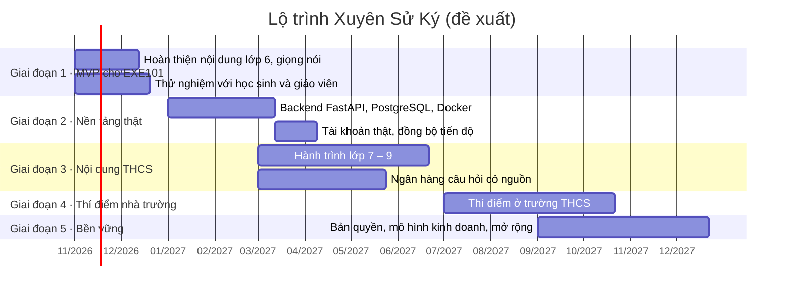

# Định hướng phát triển Xuyên Sử Ký

Tài liệu này mô tả Xuyên Sử Ký sẽ đi tiếp như thế nào sau bản demo hiện tại: mục tiêu từng giai đoạn, việc cần làm, cách đo kết quả và những rủi ro phải xử lý. Đây là **kế hoạch đề xuất** để nhóm thảo luận; mốc thời gian và chỉ số mục tiêu sẽ được nhóm chốt lại ở mỗi checkpoint.

*Cập nhật: 02/11/2026*

## 1. Tầm nhìn

> Mỗi học sinh Việt Nam được **trò chuyện với lịch sử**: đọc đúng sách giáo khoa, hỏi trực tiếp các nhân vật lịch sử, đi hết từng chương như một hành trình, và luôn biết điều mình học đến từ trang sách nào.

Ba điều Xuyên Sử Ký giữ trong mọi quyết định:

1. **Đúng sách, có nguồn.** Mọi câu trả lời dẫn về sách, bộ sách, NXB và trang. Không có nguồn thì không bịa.
2. **Đúng thời đại, đúng vai.** Nhân vật chỉ kể chuyện thời mình; chuyện đời sau thì chỉ sang người sống ở thời đó.
3. **Thầy cô là người đồng hành.** Công cụ giúp giáo viên giao bài, theo dõi và điều chỉnh, không thay thế giờ học trên lớp.

## 2. Hiện trạng (bản demo, 11/2026)

| Đã có | Còn giới hạn |
|---|---|
| Thư viện SGK lớp 6–12: 130 bài, 2.708 đoạn tư liệu có trích nguồn; tìm kiếm không dấu, hiểu tên gọi khác | Văn bản SGK thuộc bản quyền NXB Giáo dục Việt Nam, chỉ dùng cho học tập và nghiên cứu, chưa được dùng thương mại |
| 12 nhân vật AI: nhắn tin, đọc câu trả lời, trò chuyện giọng nói trực tiếp; mỗi người một giọng; không nói chuyện sau thời mình | Giọng mặc định chưa có giọng vùng miền; agent giọng nói trực tiếp cần đồng bộ lại |
| Hành trình game hoá lớp 6 (5 chương), video nhiệm vụ có thuyết minh | Hành trình mới có lớp 6; Chương 5 còn thiếu Bài 15, 17, 19, 20; video mới có Chương 2 và 1 nhiệm vụ Chương 5 |
| 3 vai trò: học sinh, giáo viên (lớp, mã lớp, giao bài, CSV), quản trị (duyệt giáo viên, khoá tài khoản) | Tài khoản, lớp học, tiến độ chỉ lưu trên trình duyệt; phân quyền mới ở giao diện |
| Học sinh chỉ thấy nội dung lớp mình | Bảng xếp hạng và một số số liệu là minh hoạ |
| CI/CD: 76 test backend, 97 test trình duyệt; deploy Vercel khi gộp vào `main` | Chưa có đánh giá chất lượng câu trả lời AI trên bộ câu hỏi thật của học sinh |

## 3. Lộ trình

### Giai đoạn 1 · Hoàn thiện MVP cho EXE101 (11 – 12/2026)

**Mục tiêu:** một bản demo chạy ổn định, đủ trọn vẹn cho lớp 6, đã được học sinh và giáo viên thật dùng thử.

- Biên soạn nốt hành trình Chương 5 lớp 6 (Bài 15, 17, 19, 20) và thêm video nhiệm vụ cho các chương còn thiếu.
- Thiết kế giọng Việt riêng cho các nhân vật học sinh hay hỏi nhất (`npm run voices:design`), đồng bộ agent giọng nói trực tiếp (`npm run sync:voice-agents`).
- Bật bảo vệ nhánh `main` trên GitHub: bắt buộc PR, CI xanh và kiểm tra định dạng commit.
- Tổ chức 2–3 buổi dùng thử với học sinh lớp 6 và 1–2 giáo viên Lịch sử; ghi lại câu hỏi học sinh thật sự đặt cho nhân vật.
- Từ các câu hỏi thật, lập **bộ đánh giá câu trả lời AI** (đúng sự kiện, đúng nguồn, đúng vai, đúng thời đại) và chạy trong CI.

**Hoàn thành khi:** học sinh tự đi hết ít nhất một chương mà không cần hướng dẫn; có báo cáo phản hồi người dùng cho checkpoint cuối kỳ.

### Giai đoạn 2 · Nền tảng thật (01 – 04/2027)

**Mục tiêu:** chuyển từ demo trên trình duyệt sang hệ thống có tài khoản thật, theo [docs/ARCHITECTURE.md](ARCHITECTURE.md).

- Backend FastAPI + PostgreSQL (pgvector) + Redis, đóng gói Docker; giữ nguyên hợp đồng `/api/*` để frontend không phải viết lại.
- Đăng nhập thật, phân quyền học sinh, giáo viên, quản trị ở máy chủ; đồng bộ tiến độ, sổ tay, lịch sử chat giữa thiết bị.
- Chuyển dữ liệu demo trong `localStorage` lên server ở lần đăng nhập đầu.
- Nhật ký kiểm toán, sao lưu cơ sở dữ liệu, giám sát lỗi và chi phí AI theo ngày.

**Hoàn thành khi:** toàn bộ test hiện có chạy xanh trên backend mới; một học sinh đăng nhập ở máy khác vẫn thấy đúng tiến độ của mình.

### Giai đoạn 3 · Nội dung đủ cấp THCS (03 – 06/2027)

**Mục tiêu:** học sinh lớp 6 – 9 đều có hành trình, câu hỏi luyện tập và nhân vật phù hợp chương trình.

- Hành trình game hoá cho lớp 7, 8, 9 bằng quy trình `course_builder` hiện có (mỗi câu trích được kiểm khớp nguyên văn SGK).
- **Ngân hàng câu hỏi có nguồn**: giáo viên soạn, quản trị duyệt; mỗi câu gắn đoạn SGK làm căn cứ.
- Mở rộng mốc sự kiện và tên gọi khác theo từng lớp; thêm nhân vật theo chương trình THCS khi có đủ tư liệu.
- Lọc tư liệu của nhân vật theo thời đại (bổ sung cho cơ chế mốc thời gian đã có), để câu không nêu tên vẫn không lẫn chuyện đời sau.

**Hoàn thành khi:** mỗi lớp 6 – 9 có ít nhất một học kỳ hành trình; bộ đánh giá AI đạt ngưỡng nhóm đặt ra cho cả 12 nhân vật.

### Giai đoạn 4 · Thí điểm ở nhà trường (07 – 10/2027)

**Mục tiêu:** chứng minh Xuyên Sử Ký giúp ích trong lớp học thật.

- Thí điểm với một số lớp THCS: giáo viên tạo lớp, giao bài theo tuần, xem báo cáo tiến độ.
- Báo cáo cho giáo viên: bài học sinh hay bỏ dở, câu hỏi hay sai, chủ đề học sinh tò mò nhất.
- Chế độ trên lớp: giáo viên trình chiếu hành trình, cả lớp cùng trả lời.
- Khảo sát trước – sau thí điểm về hứng thú và kết quả học Lịch sử.

**Hoàn thành khi:** có số liệu thí điểm đủ để thuyết phục nhà trường và nhà đầu tư.

### Giai đoạn 5 · Bền vững và mở rộng (từ 09/2027)

**Mục tiêu:** sản phẩm vận hành lâu dài, hợp pháp và có nguồn thu.

- **Bản quyền nội dung:** đàm phán với NXB Giáo dục Việt Nam hoặc chuyển sang nguồn có giấy phép phù hợp trước khi phát hành rộng rãi.
- **Mô hình kinh doanh** (giả thuyết cần kiểm chứng ở giai đoạn 4): miễn phí cho học sinh với hạn mức AI; gói cho trường hoặc giáo viên có lớp học, báo cáo và giọng nói không giới hạn.
- Ứng dụng di động hoặc PWA dùng được khi mạng yếu; hỗ trợ học sinh khiếm thị (đọc toàn bộ nội dung, điều hướng bằng bàn phím).
- Mở rộng sang lớp 10 – 12 và nội dung địa phương (lịch sử tỉnh, di tích quanh trường).

## 4. Chỉ số theo dõi

Nhóm chốt con số mục tiêu sau giai đoạn 1, khi đã có dữ liệu thật.

| Nhóm | Chỉ số | Đo bằng |
|---|---|---|
| Học tập | Tỉ lệ học sinh hoàn thành một chặng, một chương | Tiến độ hành trình |
| Học tập | Tỉ lệ nắm vững (đúng ngay lần đầu ở hai ngày khác nhau) | Luật hành trình hiện có |
| Chất lượng AI | Tỉ lệ câu trả lời đúng sự kiện, đúng nguồn, đúng vai, đúng thời đại | Bộ đánh giá trong CI |
| Gắn bó | Học sinh quay lại trong 7 ngày; chuỗi ngày học | Nhật ký học |
| Giáo viên | Số lớp đang hoạt động, số bài giao mỗi tuần | Khu giáo viên |
| Chi phí | Chi phí AI và giọng nói trên mỗi học sinh mỗi tháng | Log token, hạn mức |
| Tin cậy | Thời gian hoạt động, số lần deploy lỗi | Vercel, GitHub Actions |

## 5. Rủi ro và cách xử lý

| Rủi ro | Ảnh hưởng | Cách xử lý |
|---|---|---|
| Văn bản SGK chưa được phép dùng thương mại | Không thể thu phí hay phát hành rộng | Xin phép NXB Giáo dục Việt Nam trước giai đoạn 5; tách dữ liệu SGK khỏi phần nhóm tự biên soạn để thay nguồn khi cần |
| AI trả lời sai hoặc lệch vai | Mất niềm tin của giáo viên, phụ huynh | Luôn trích nguồn; guardrail, mốc thời gian; bộ đánh giá trong CI; nút báo lỗi câu trả lời |
| Nội dung nhạy cảm về lãnh tụ, chính trị | Rủi ro uy tín | Chỉ dùng dữ kiện SGK; giọng mô phỏng, không sao chép giọng thật; có quy trình duyệt nội dung |
| Dữ liệu cá nhân học sinh chưa thành niên | Vi phạm quy định | Thu thập tối thiểu; tuân thủ quy định hiện hành về bảo vệ dữ liệu cá nhân; cho phép xoá tài khoản |
| Chi phí OpenAI, ElevenLabs tăng theo số học sinh | Không bền vững | Hạn mức theo người dùng; cache; câu trả lời không cần AI khi có thể; thuyết minh thu sẵn |
| Phụ thuộc một nhà cung cấp | Gián đoạn dịch vụ | Giữ chế độ trích SGK khi tắt AI; giọng trình duyệt làm dự phòng; tách lớp tích hợp để đổi nhà cung cấp |
| Nhóm nhỏ, thời gian có hạn | Trễ tiến độ | Ưu tiên theo giai đoạn; mỗi giai đoạn có tiêu chí hoàn thành rõ; quy trình Git và CI giữ chất lượng |

## 6. Việc nhóm cần quyết định

- Đối tượng chính trong năm đầu: chỉ THCS (lớp 6 – 9) hay cả THPT.
- Ngân sách cho ElevenLabs (gói Creator đủ 12 giọng Việt riêng) và OpenAI trong giai đoạn thí điểm.
- Trường và giáo viên đối tác cho giai đoạn 4.
- Hướng xử lý bản quyền nội dung SGK.
- Chỉ số mục tiêu cụ thể cho từng giai đoạn.

## 7. Cập nhật tài liệu này

Cập nhật sau mỗi checkpoint EXE101 hoặc khi một giai đoạn hoàn thành: đánh dấu việc đã xong, chuyển việc trễ sang giai đoạn sau, ghi lại quyết định ở mục 6. Commit theo quy ước `docs: update roadmap after <mốc>` (xem [CONTRIBUTING.md](../CONTRIBUTING.md)).
